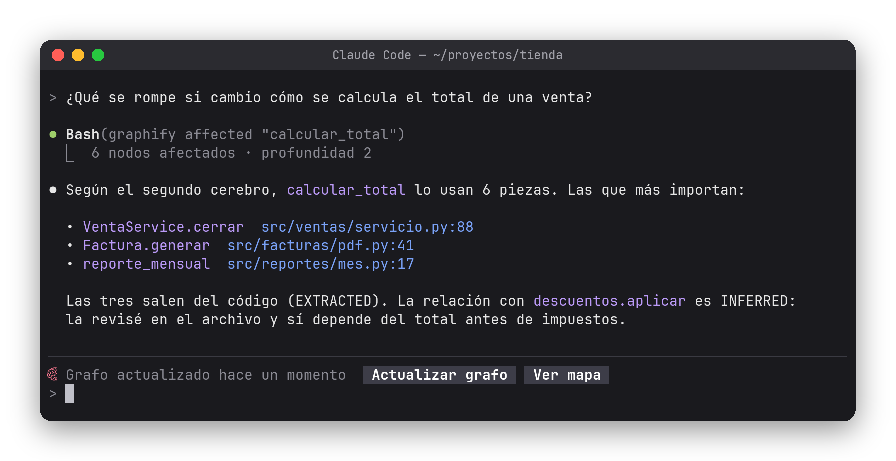
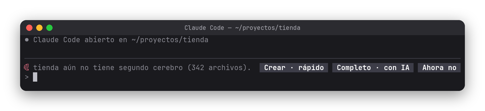

# 🧠 Segundo cerebro — Claude recuerda tu proyecto

Un mod para [Claude Code](https://claude.com/claude-code) que le da a Claude un **segundo cerebro** de cada proyecto: un grafo de conocimiento hecho con [graphify](https://pypi.org/project/graphifyy/) donde cada archivo, clase y función es un nodo y sus relaciones son aristas.

El mod hace todo lo que normalmente harías a mano: **instala graphify, crea el grafo con un clic, lo mantiene al día solo y le enseña a Claude a consultarlo** antes de abrir archivos uno por uno. Claude responde con menos tokens y encuentra conexiones que una búsqueda de texto no ve.



## Instalación

Escribe esto en el prompt de Claude Code:

```
/plugin install segundo-cerebro --marketplace waldooCreator/claude-code-segundo-cerebro
```

Responde `y` para agregar el marketplace y elige el alcance **user** (Enter). Queda activo en todas tus sesiones. No hay nada más que configurar: abre Claude Code en la carpeta de un proyecto y el mod te guía.

<details>
<summary>Otras formas de instalarlo</summary>

Desde una terminal normal:

```bash
claude plugin install segundo-cerebro --marketplace waldooCreator/claude-code-segundo-cerebro
```

En la app de escritorio: clic en **+** junto al cuadro del prompt, luego **Plugins**, **Add marketplace** con `waldooCreator/claude-code-segundo-cerebro` y después **Add plugin**.

Probarlo sin instalar:

```bash
git clone https://github.com/waldooCreator/claude-code-segundo-cerebro.git
claude --plugin-dir ./claude-code-segundo-cerebro
```

</details>

## Cómo se usa

**1. Si no tienes graphify**, la franja sobre el prompt ofrece **Instalar graphify**. El mod lo instala con `uv`, `pipx` o `pip` (el primero que encuentre) y deja la skill oficial de graphify en Claude Code.

**2. Si el proyecto no tiene grafo**, te ofrece crearlo:



| Botón | Qué hace | Costo |
| --- | --- | --- |
| **Crear · rápido** | Lee el código (`graphify update .`). Segundos. | Gratis, sin IA |
| **Completo · con IA** | Claude lee también documentos, PDFs e imágenes con la skill `graphify`. | Usa tokens |
| **Ahora no** | No vuelve a ofrecerlo en ese proyecto. | — |

**3. Desde ahí, no tienes que hacer nada:**

- 🔄 **Se actualiza solo.** Cuando Claude edita código del proyecto, al terminar el turno el grafo se pone al día en silencio (solo avisa si algo falla).
- 🧭 **Claude lo usa siempre.** El mod le indica en cada sesión que consulte el grafo antes de buscar a mano, que confirme en los archivos y que distinga lo que sale del código de lo que es una inferencia.
- 📚 **Skill incluida.** `segundo-cerebro` le explica a Claude qué comando usar para cada pregunta (`query`, `path`, `explain`, `affected`, `god-nodes`), cómo leer `GRAPH_REPORT.md` y las etiquetas EXTRACTED / INFERRED / AMBIGUOUS.
- 🗺️ **Mapa interactivo.** El botón **Ver mapa** abre `graph.html` en el navegador.

## Comandos

| Comando | Qué hace |
| --- | --- |
| `/cerebro` | Estado del grafo y de graphify |
| `/cerebro crear` | Crea el grafo del código (rápido, sin IA) |
| `/cerebro completo` | Grafo con código, documentos e imágenes (lo hace Claude, usa tokens) |
| `/cerebro actualizar` | Pone el grafo al día con el código |
| `/cerebro forzar` | Actualiza aunque el grafo nuevo tenga menos nodos (después de borrar código) |
| `/cerebro abrir` | Abre el mapa interactivo |
| `/cerebro auto on` · `off` | Enciende o apaga la actualización automática |
| `/cerebro instalar` | Instala o actualiza graphify |

## Bueno saber

- **¿Qué carpeta toma como proyecto?** La más cercana hacia arriba que tenga `graphify-out/`; si no hay, la raíz del repositorio git. En tu carpeta personal no ofrece nada.
- **El grafo vive en `graphify-out/`** dentro del proyecto. Agrégalo a tu `.gitignore` si no quieres subirlo.
- **Requisitos:** Python 3.10 o más reciente y, mejor, [uv](https://docs.astral.sh/uv/). En Linux, para que «Ver mapa» abra el navegador, `xdg-open`.
- `graphify query` busca por palabras exactas en los nombres del código, no entiende frases. Claude ya lo sabe por la skill; si lo usas tú, pregúntale con identificadores: `graphify query "login auth session"`.

## Cómo funciona

```
hooks/register.tsx               la franja, /cerebro, la actualización automática y la instrucción para Claude
skills/segundo-cerebro/SKILL.md  cómo usar el grafo (la lee Claude)
types/index.d.ts                 el estado que comparten la franja y el comando
tests/                           pruebas (claude plugin test)
```

El mod se engancha a `tool.call` (Claude editó un archivo de código del proyecto), `turn.complete` (al terminar el turno corre `graphify update .`), `prompt.compose` (agrega la instrucción solo cuando hay grafo) y dibuja la franja con `ui.render` sobre el prompt.

## Desarrollo

```bash
claude plugin validate .   # valida el manifiesto, el marketplace y los hooks
claude plugin test .       # corre las pruebas
claude --plugin-dir .      # abre una sesión con el mod cargado desde esta carpeta
```

<details>
<summary>🇬🇧 In English</summary>

**Segundo cerebro** ("second brain") is a Claude Code mod that automates [graphify](https://pypi.org/project/graphifyy/) for any project. It installs graphify (via uv, pipx or pip), builds the project's knowledge graph in one click (fast code-only mode, or a full mode where Claude also reads docs and images), keeps it updated after every turn in which Claude edits code, and tells Claude to query the graph before searching files by hand. It ships a skill explaining which graphify command fits each question.

Install: `/plugin install segundo-cerebro --marketplace waldooCreator/claude-code-segundo-cerebro`, then open Claude Code inside a project. The UI is in Spanish.

</details>

## Créditos y aviso

[graphify](https://pypi.org/project/graphifyy/) es un proyecto de código abierto de sus autores; este mod solo lo instala y lo automatiza. Proyecto personal, **no oficial**: no está afiliado a Anthropic ni a graphify.

## Licencia

[MIT](LICENSE)
